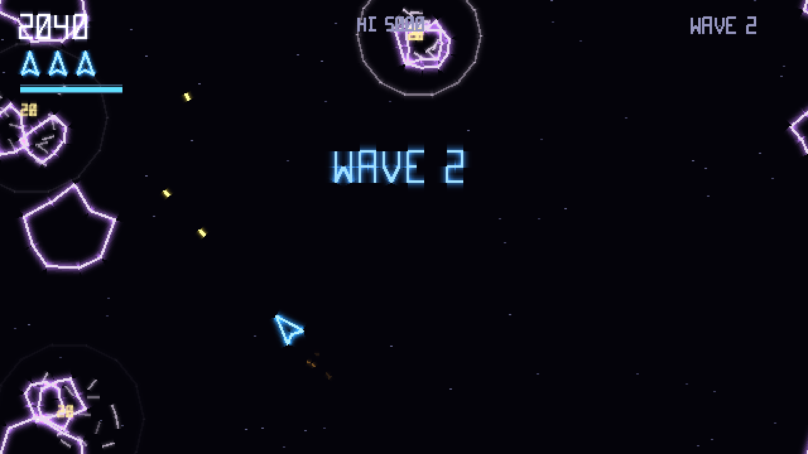

# Rockfield + vector.h for Vircon32

Version 1.0. A vector-graphics arcade game for the Vircon32 fantasy console, and the vector drawing library it's built on.

**Rockfield.v32** is the ready-to-play cartridge. Load it in the Vircon32 emulator.



More screenshots are in `screenshots/`. See `CHANGELOG.md` for everything in this release.

## Controls

| Input | Action |
|---|---|
| Left / Right | Rotate |
| Up or A | Thrust |
| B | Fire (hold for auto-fire) |
| X | Hyperspace |
| Y | Shield (hold) |
| Start | Start game / pause menu |

The pause menu has Resume, Options and Quit to Title. Quitting needs a second press of B, and a game you quit isn't scored. Options opened from the pause menu return to it, with the game still frozen.

On the initials entry screen, Up and Down change the letter, Left and Right move between letters, B moves on to the next letter, and Start finishes. Entry confirms by itself after 30 seconds.

## Options

Press Y on the title screen. Up and Down select a setting, Left and Right change it, and Start (or Back) returns to the title.

| Option | What it does |
|---|---|
| Music volume / Effects volume | 0–10. Takes effect immediately, and the effects slider plays a sample sound. |
| Difficulty | Easy, Normal or Hard (see below). |
| Screen shake | On or off. |
| Screen flashes | On or off. Turns off the full-screen flashes from deaths, pickups and hyperspace. |
| Reset high scores | Press B twice. Restores the default table and the built-in demo. |

The difficulty settings:

| | Easy | Normal | Hard |
|---|---|---|---|
| Lives | 5 | 3 | 2 |
| Rock speed | ×0.8 | ×1 | ×1.2 |
| Power-up drops | ×2 | ×1 | ×0.5 |
| Saucers | Appear later, aim worse; small ones from 5000 points | Standard | Appear sooner, aim better; small ones from 1500 points |
| Large rocks split in three from wave | 4 | 3 | 2 |
| Armored rocks from wave | 5 | 4 | 3 |

High score entries remember their difficulty. Easy scores show a small green **E** in the table, and Hard scores a red **H**. A recorded demo also remembers its difficulty, so it replays under the same rules.

Options are saved to the memory card when you leave the options screen, and loaded with the card.

## Shield, power-ups and waves

**Shield.** Hold Y to raise it. While it's up:

- rocks you touch are destroyed;
- saucer shots are absorbed;
- saucers that ram you are destroyed.

Each of these costs energy. Holding the shield drains about 5 seconds' worth of energy, and the meter under your lives recharges while the shield is down. You start each life with a full meter.

**Power-ups** drop now and then from rocks you destroy, and always from saucers. They drift around for 10 seconds, blinking before they fade out. Fly into one to collect it:

| Icon | Effect |
|---|---|
| Pink `3` | Spread shot: three bullets per shot, for 12 seconds |
| Yellow `R` | Rapid fire, for 12 seconds |
| Cyan `E` | Refills the shield |

Active power-ups show under the shield meter, with bars that shrink as they run out. You lose them when your ship is destroyed.

**Waves get harder.** Rocks get a little faster every wave. Two rules are added along the way, and each is announced under the wave banner the first time it applies:

| From wave | New rule |
|---|---|
| 3 | Large rocks split into three pieces instead of two |
| 4 | Armored rocks appear. They're drawn with an inner plate, take two hits, and are worth double. Their share of each wave grows, up to 60% |

## Music

The music is played by a small note sequencer on the console (`chipmusic.h`), the way 8-bit consoles did it. There are no recordings of the songs, so the whole ROM is about 1.8 MB (rendered music had made it about 14 MB).

How it works:

- The ROM holds eight tiny instrument samples: three pulse (square) waves, a stepped triangle, and four drums.
- `make_music.py` holds the songs as note strings and exports them as note events into `music_data.h`, about 12 KB.
- Every frame, the engine starts any notes due on that frame. It sets each note's pitch through the channel's playback speed and shapes its volume: a decay toward a sustain level, then a quick release. It also adds vibrato to long lead notes.
- Tempos are chosen so a sixteenth note is a whole number of frames, so every note starts exactly on a frame.

| Track | Where it plays |
|---|---|
| Title theme (A minor, 150 BPM, 25.6 s loop) | Title screen, score table, attract demo, initials entry, and softly after the game over jingle |
| In-game loop (D minor, 112.5 BPM, 34 s loop) | During play. It has no kick or snare, so the game's heartbeat stays the beat, and its bass sits above the heartbeat's register. |
| Game over jingle (7 s) | When a game ends without making the table |

Sound channels:

| Channels | Used for |
|---|---|
| 0 | Thrust |
| 1 | Saucer |
| 2 | Shield |
| 3–9 | Music (one per voice) |
| 10–15 | Effects, used in rotation |

Asking for the track that's already playing only changes its volume, so the title theme carries on across the title pages and into the demo. The attract demo mutes effects only, not the music.

To change a tune, edit the note strings in `make_music.py` (one token per step: a note such as `A4`, `-` to hold, `.` to rest), then rerun `make_sounds.py` and rebuild. Each song may use at most 7 voices at once. The script stops with an error if a song needs more.

Two Vircon32 sound details matter here:

- A channel only accepts a new sound once it's stopped, so the engine and the effects stop a channel before reusing it.
- The chip doesn't clamp its mix. Loud overlaps wrap around into a crack, so the master volume leaves headroom.

## Attract mode

When nobody is playing, the title screen cycles between three pages:

1. The logo, for 8 seconds.
2. The high score table, for 6 seconds.
3. A demo, replaying a recorded game silently for up to 45 seconds.

Pressing Start at any point begins a real game.

The demo is a replay of real inputs, not a scripted animation. Every game records its inputs (6 bits per frame, the first 60 seconds), and the game logic uses its own random number generator, seeded at the start of each game. Replaying the same seed and inputs reproduces the game exactly.

A finished game becomes the new demo if it beats the current demo's score and lasted at least 10 seconds. Until then, a built-in demo (`demo_builtin.h`) is used.

## Saving to the memory card

Insert a memory card and Rockfield saves its top five table and the demo recording. The title screen shows the card's status.

- A blank card is claimed with the signature `ROCKFIELD VECTOR V1 `.
- A card that already belongs to another game is never written to.
- The table and the demo each have their own checksum. A damaged part is ignored and the defaults are used instead.
- A card inserted while the title screen is showing is picked up straight away. Its scores are merged into the current table, and its demo is used if it's a better game.
- Cards saved by earlier versions still load:
  - **Format 2:** the table is kept. Its demo is dropped, because it was recorded under the old rules and wouldn't replay correctly.
  - **Format 1:** that version saved a single high score, which enters the table under the initials `---`.

Card layout, in 32-bit words:

| Words | Contents |
|---|---|
| 0–19 | Game signature |
| 20 | Format version (3) |
| 21–25 | Table scores |
| 26–30 | Table initials (3 characters packed, 8 bits each, plus the difficulty in the top byte) |
| 31–33 | Demo seed, demo length in frames, demo score |
| 34 | Checksum of words 21–33 |
| 35 | Checksum of the demo data |
| 36 | Options (music, effects, difficulty, shake and flash, packed) |
| 37 | Checksum of words 36 and 38 |
| 38 | Difficulty the demo was played on |
| 40–759 | Demo recording |

## Files

- `LICENSE`: MIT license.
- `CHANGELOG.md`: what's in each release.
- `screenshots/`: title, gameplay, high scores and options screens.
- `vector.h`: the vector graphics library. Its API is documented at the top of the file.
- `vector_lines.png`: the small texture the library draws its lines from.
- `Rockfield.c`, `Rockfield.xml`: the game source and its ROM definition.
- `demo_builtin.h`: the built-in attract demo, generated by `tools/gen_demo.py`.
- `make_sounds.py`: synthesizes all sound effects and the music instruments into `sounds/`, and regenerates `music_data.h`. It writes `.wav` files to listen to and `.vsnd` files for the ROM. It needs Python 3 with NumPy.
- `make_music.py`: the songs, and the instrument samples. It generates `music_data.h`.
- `chipmusic.h`: the console music engine.
- `music_data.h`: the songs as note events (generated).
- `sounds/`: the generated sounds and music.
- `tools/headless.cpp`: a headless runner for testing. It runs a ROM on the official emulator's console code without a window. It can:
  - script gamepad input;
  - save frames and audio;
  - attach a memory card file;
  - report dropped frames.
- `tools/gen_demo.py`: plays several scripted games with the headless runner and turns the best recording into `demo_builtin.h`.

## Building

With the Vircon32 dev tools on your PATH, and Python 3 with NumPy, run these from this folder:

```
python3 make_sounds.py
png2vircon vector_lines.png -o vector_lines.vtex
mkdir -p obj
compile Rockfield.c -o obj/Rockfield.asm
assemble obj/Rockfield.asm -o obj/Rockfield.vbin
packrom Rockfield.xml -o Rockfield.v32
```

`make_sounds.py` also regenerates `music_data.h`. The result is identical to the included `Rockfield.v32`.

The order of the sounds in `Rockfield.xml` must match the `SND_` numbers in `Rockfield.c`. That is the same order as the `SOUNDS` list in `make_sounds.py`.

To build the headless runner, compile it together with the console logic from the official emulator source (`DesktopEmulator/ConsoleLogic` in the `vircon32/ComputerSoftware` repository). Run this from the `DesktopEmulator` folder:

```
g++ -O2 -std=c++14 -I. path/to/headless.cpp ConsoleLogic/*.cpp -o headless
```

Its usage is described in the comments at the top of `main()` in `headless.cpp`.

## Keeping replays exact

If you change the game, these rules keep recorded demos replaying correctly:

- Game logic only reads input through the input layer (`in_bits`, `fire_frames`, `hyper_frames`), never the gamepad directly.
- Game logic only uses `grand()` / `frand()`. Visual-only randomness uses `fxrand()` / `fx_range()`, because drawing also runs while the game is paused.
- `begin_game()` must reset every piece of gameplay state.
- Changing any gameplay rule changes how old recordings play out. After such a change, regenerate `demo_builtin.h` and bump the save format version.

## Vircon32 C notes

- Arrays are declared as `float[ 10 ] name;`, not `float name[ 10 ];`.
- There is no `? :` operator.
- You can't add to an array name. Pass `&array[ n ]` instead of `array + n`.
- A function must be declared before it's used. Add a prototype like `void foo();` when needed.
